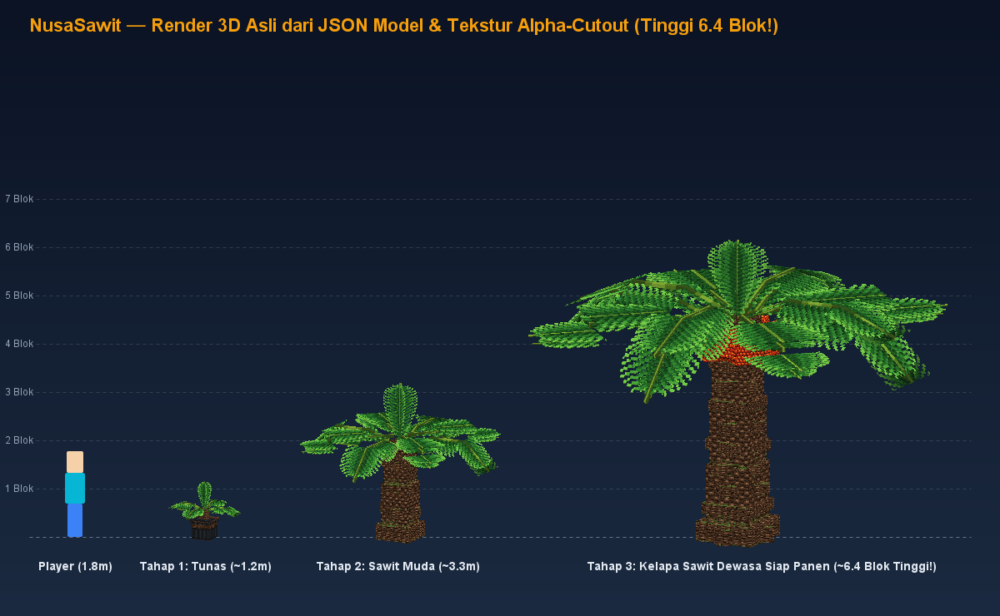
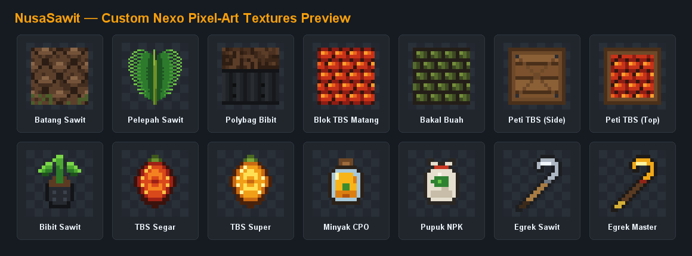

# NusaSawit

Plugin perkebunan kelapa sawit modern untuk **NusaSpigot / Paper 1.21.11** (Java 21) dengan model pohon 3D realistis berbasis **Nexo** serta sistem ekonomi lengkap berbasis **Vault**.





---

## Fitur Utama

### 1. Lisensi Perkebunan Kayu Alami (Anti-Exploit)
- Pemain wajib menebang **20.000 blok kayu alami** (default `OAK_LOG` / `OAK_WOOD`, dapat diubah langsung via GUI Admin) untuk membuka **Lisensi Perkebunan Sawit** dan mendapatkan **1x Bibit Sawit Tenera** gratis.
- Dilengkapi pelacak chunk PDC anti-exploit sehingga blok kayu yang dipasang pemain atau digeser piston tidak dihitung.
- Setiap kelipatan tebangan berikutnya (`10.000` kayu secara default) memberikan hadiah bibit tambahan secara otomatis.

### 2. Pohon Sawit 3D Tinggi Realistis (Nexo Furniture) & Panen Berulang
- **Tahap 1 (`sawit_stage_1`)**: Tunas kelapa sawit di dalam polybag hitam.
- **Tahap 2 (`sawit_stage_2`)**: Pohon sawit muda dengan batang bersisik serat pelepah dan tajuk daun melengkung.
- **Tahap 3 Berbunga (`sawit_stage_3_growing`)**: Pohon kelapa sawit dewasa tinggi (~6,4 blok) dengan tajuk pelepah 3D berlapis dan tandan bunga muda.
- **Tahap 3 Siap Panen (`sawit_stage_3_ripe`)**: Pohon sawit dewasa dengan **Tandan Buah Segar (TBS) merah-oranye** menggantung di bawah tajuk pelepah — dapat dipanen berulang kali tanpa menebang pohon!

### 3. Alat Panen Egrek, Pupuk NPK, Kilang CPO & Koperasi (`/sawit`)
- **Pupuk NPK Sawit (`pupuk_npk`)**: Klik kanan pohon sawit untuk mempercepat waktu tumbuh dan pematangan buah.
- **Egrek Panen Sawit (`egrek_sawit`) & Egrek Baja Nusantara (`egrek_master`)**: Sabit galah khusus panen yang memberikan bonus jumlah TBS serta peluang tinggi mendapatkan **TBS Tenera Super**.
- **Kilang Minyak Sawit (CPO)**: Mengolah TBS biasa menjadi botol **Minyak Sawit Mentah (CPO)** bernilai jual premium.
- **Upgrade Kapasitas Lahan**: Batas slot pohon per pemain yang dapat ditingkatkan menggunakan saldo Vault agar ekonomi dan performa server tetap terjaga.
- **Proteksi Kepemilikan & Klaim**: Pohon terkunci untuk pemiliknya dan terintegrasi dengan plugin proteksi wilayah (WorldGuard, GriefPrevention, Lands, dll.).

### 4. In-Game Admin GUI (`/sawit admin`)
- Ubah harga jual **TBS**, **TBS Super**, **CPO**, biaya olah & rasio **Kilang CPO**, harga toko item, waktu tumbuh tiap tahap, kapasitas slot kebun, hingga **target tebang kayu lisensi** langsung dari dalam game (via tombol klik atau input angka di chat) dan otomatis tersimpan ke `config.yml` tanpa restart.

---

## Instalasi

1. Unduh `NusaSawit-1.0.0.jar` dari halaman **Releases** (atau hasil build dari `build/libs/NusaSawit-1.0.0.jar`), lalu masukkan ke folder `plugins/` server **Paper / NusaSpigot 1.21.11** bersama **Nexo** dan **Vault** (+ provider ekonomi seperti EssentialsX / CoinsEngine / CMI).
2. Nyalakan server. `NusaSawit` akan **otomatis mengekspor** konfigurasi `items/nusasawit.yml`, 16 tekstur PNG custom, dan 5 model JSON 3D ke dalam folder `plugins/Nexo/`.
   *(Salinan aset manual juga tersedia di folder [`nexo-pack/`](nexo-pack/)).*
3. Jalankan perintah berikut untuk me-reload item & resource pack Nexo:
   ```text
   /nexo reload all
   ```

---

## Perintah & Permission

| Perintah | Deskripsi | Permission |
| :--- | :--- | :--- |
| `/sawit` | Membuka GUI Utama Kebun, Koperasi Jual, Kilang CPO, Upgrade Slot & Toko | `nusasawit.use` |
| `/sawit sell` | Menjual cepat seluruh TBS, TBS Super & CPO di inventory | `nusasawit.use` |
| `/sawit progress` | Menampilkan progres tebang kayu alami & ringkasan kebun | `nusasawit.use` |
| `/sawit claim` | Mengklaim hadiah bibit sawit yang tertunda | `nusasawit.use` |
| `/sawit admin` | Membuka **GUI Pengaturan Admin** (harga TBS/CPO, target kayu, durasi tumbuh, dll.) | `nusasawit.admin` |
| `/sawit admin give <player> <item> [jumlah]` | Memberikan item custom NusaSawit ke pemain | `nusasawit.admin` |
| `/sawit admin setwood <player> <jumlah>` | Mengatur progres tebang kayu alami pemain | `nusasawit.admin` |
| `/sawit admin unlock <player>` | Membuka langsung Lisensi Perkebunan Sawit pemain | `nusasawit.admin` |
| `/sawit admin addslots <player> <jumlah>` | Menambah bonus slot maksimal pohon sawit pemain | `nusasawit.admin` |
| `/sawit admin cleanup` | Membersihkan entitas visual sawit orphan di chunk aktif | `nusasawit.admin` |
| `/sawit admin syncnexo` | Menyalin ulang seluruh model 3D & tekstur ke `plugins/Nexo/` | `nusasawit.admin` |
| `/sawit admin reload` | Memuat ulang konfigurasi `config.yml` | `nusasawit.admin` |

---

## Build dari Source

 Membutuhkan **JDK 21**:

```bash
./gradlew build
```

File JAR siap pakai akan dihasilkan di `build/libs/NusaSawit-1.0.0.jar`.
